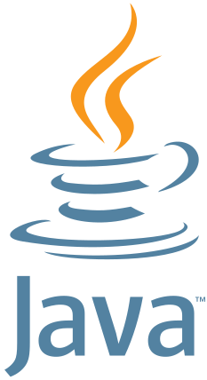
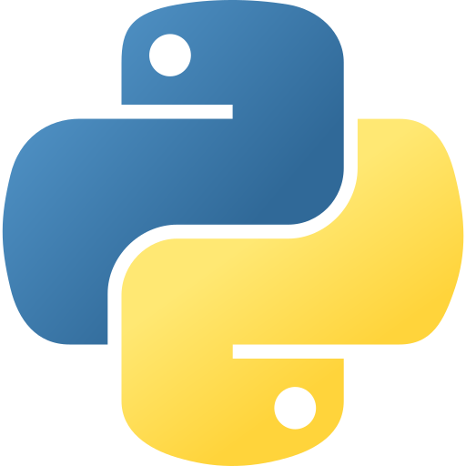
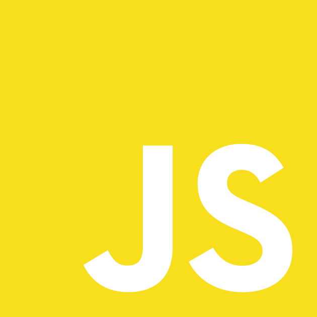
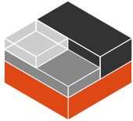
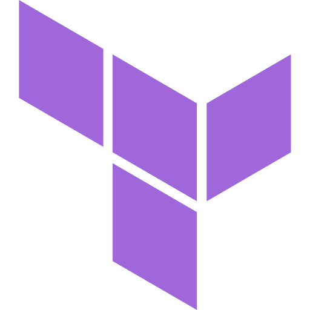

# 👋Hello ! I am Matthieu Sauboua-Beneluz, a passionate software engineer

Developer by day🌅, system administrator by night 🌙, public speaker 🎤

## Developer Experience

- Currently working at [Shodo Lyon](https://shodo.io/)
  - Expert in  Java,  .NET 
  -  Python enthusiast
  - Software craftsmanship practises: [DDD](https://en.wikipedia.org/wiki/Domain-driven_design), [TDD](https://en.wikipedia.org/wiki/Test-driven_development)
  - 🤖 AI assisted programming with some relevant crafting practises

I am also familiar with technologies like  Scala,  Javascript,  Typescript and their ecosystems.

What I like to find in the projects I work on:
- 🤔 Complex business logic
- 👤 Real user impact, proximity to final users of the product if possible
- 🚀 Ownership: from discussion with the product team to running the project in production

## Sys-Admin Experience

- Put a Homelab 🧪 rack in place from scratch
  - Second-Hand server and network hardware setup
  - Familiarisation with  [Ubuntu-Server](https://ubuntu.com/download/server),  [Debian](https://www.debian.org/) and  [Alpine](https://www.alpinelinux.org/) distributions
  - From Bare-Metal to virtualization with  [Incus](https://linuxcontainers.org/incus/) and  [Proxmox](https://www.proxmox.com/en/)
  - Automation practises ( [Ansible](https://docs.ansible.com/projects/ansible/latest/index.html), [Pyinfra](https://pyinfra.com/),  [Terraform](https://developer.hashicorp.com/terraform))

I wrote a conference to share my experience on this project, available on  [Codeberg](https://codeberg.org/matthieusb/conference-self-hosting)

## Community

I am mostly active in the Python, Software Crafters and FOSS communities in Lyon, France.

- Vice-President at [AFPY - French-Speaking Python Association](https://www.afpy.org/)
  - Usually present at the [Lyon Python meetups](https://www.meetup.com/fr-FR/python-afpy-lyon/) and PyconFR

